# OncoMind — AI-driven Cancer Analysis Starter

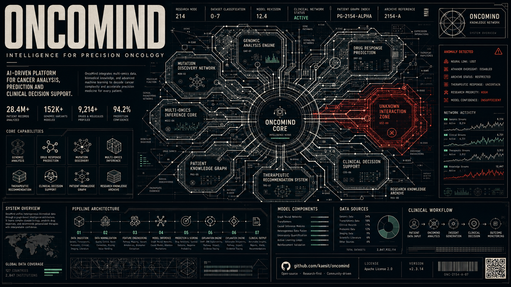


## What it does?
OncoMind is an AI driven cancer analysis platform, it's purpose is complex but meaningful

- 🧬 Cancer data analysis using ML models trained on public research datasets

- 🧪 Synthetic Molecules Generated by Custom AI Models to Provide Candidate Cancer Drugs (for research only)

- 🧠 Decision-support experimentation for treatment optimization workflows (for research only)

- 📊 Clinical analytics dashboards for exploratory insights

- 📘 Patient awareness & educational guides (non-diagnostic)

In this project, we will use scientific research data on cancer and AI models fine tuned or specifically trained with this research in an integrated way to perform many tasks such as the production of personalized cancer drugs in a highly experimental way, modules that optimize the treatment process on behalf of doctors, and visualizing tumor and CT images in 3D and using them in the treatment process.
And lastly we will provide awareness guides for our precious patients 


---

## Details for developers
<details>

## 🚀 Quickstart (Local, Requires Docker)

Will be in live soon[oncomind.ai]


```bash
# from repo root
docker compose up --build
# open frontend: http://localhost:5173
# API: http://localhost:5001/api/predict?sample=1
# ML service: http://localhost:8000/predict?sample=1
````

---


## ⬇️ Requirements
#### Packages

```bash
fastapi
uvicorn[standard]
numpy
pandas
scikit-learn
pydantic
pytest
opencv-python
tensorflow
kaggle
tissue-detection
PyOpenGL
pyvista
skimage
glfw
pygame
pydantic_settings
pip-audit
bandit
httpx
```

#### How to install packages:
```bash
pip install -r requirements.txt
```


---

## 🧪 Test

### Test Files


#### how to start the app

Run with:

```bash
uvicorn app:app --reload --host 127.0.0.1 --port 8000
```

#### early_diagnosis_test_from_image.py

Run with:

```bash
python early_diagnosis_test_from_image.py --model MODEL_PATH\<model_name>.pt --test-image PATH_OR_URL
```

#### test_or_diagnosis_from_video_source.py

Run with:

```bash
python early_diagnosis_test_from_image.py --model MODEL_PATH\<model_name>.pt --video-source VIDEO_PATH
```

---

## Pages

The dashboard is built with visx (charts), Radix UI primitives and TanStack Table on top of a custom design system, with light and dark themes.

### Sign In Page
Secure access for medical personnel.
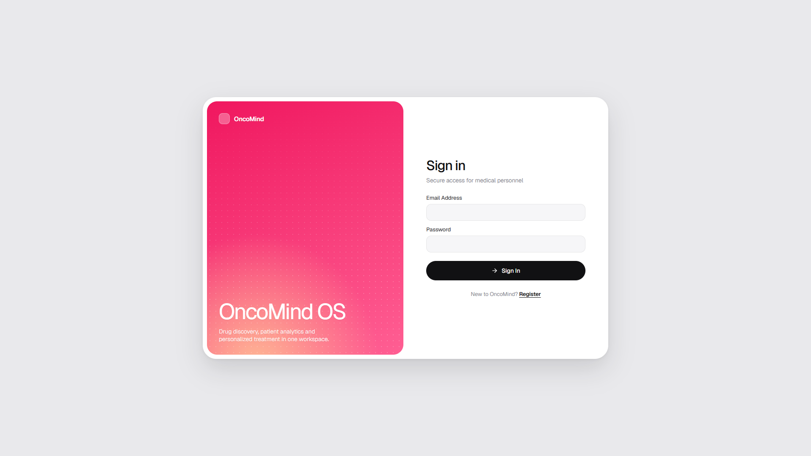

### Sign Up Page
Doctor profile registration with specialization and date of birth.
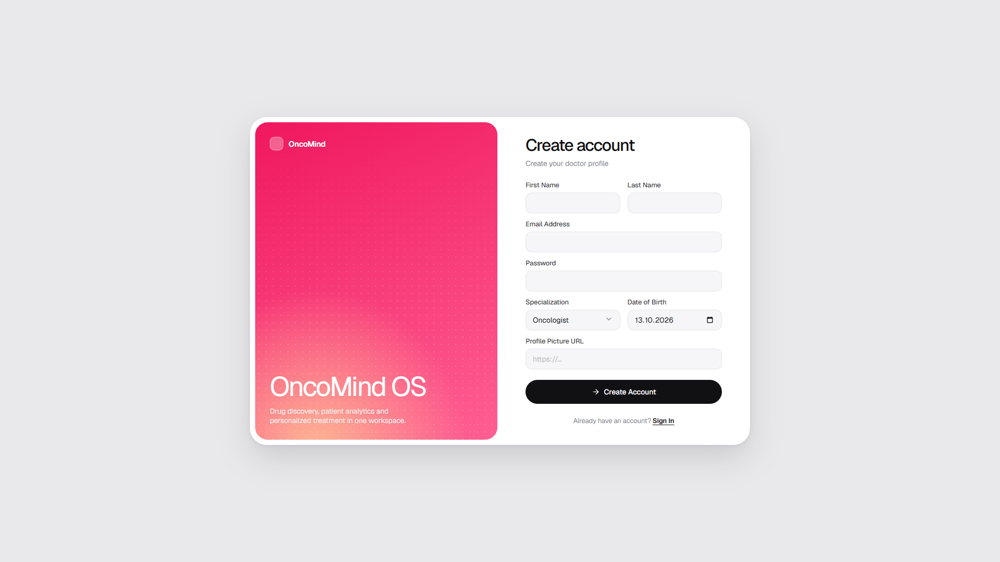

### Overview
All patients at a glance: total, occupied rooms and urgent cases, plus a patient registry with per-column filters, sorting and an estimated AI diagnosis.
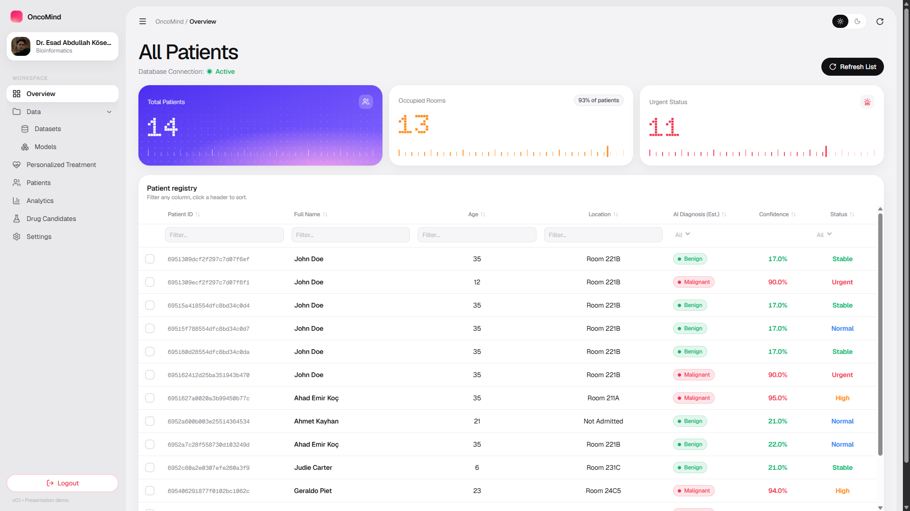

### Menu
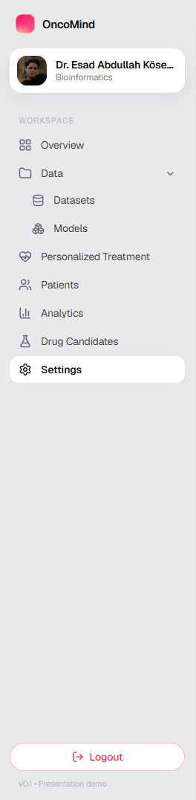

### Datasets Page
Imaging datasets used for training, with selection, train and delete actions.
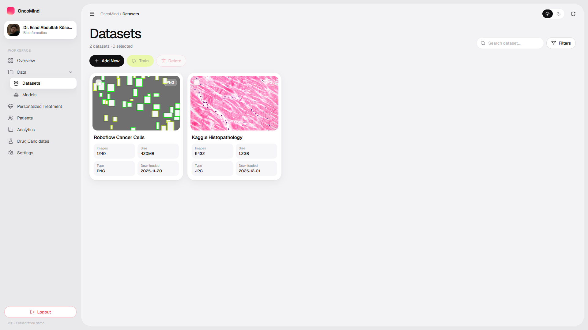

### Models Page
Trained models with their type, size and training date.
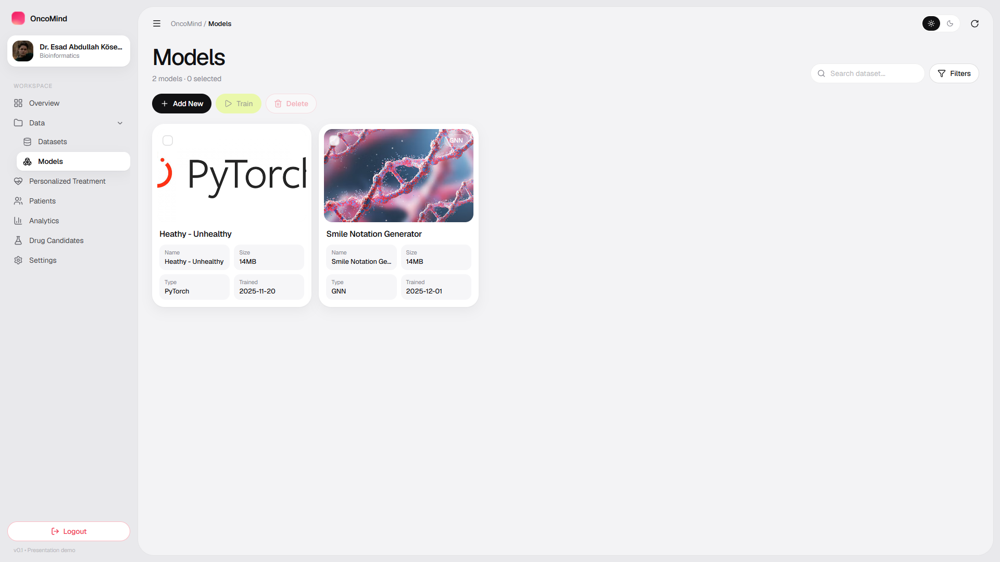

### Personalized Treatment Page
Entry point for drug, CT image and genomic profiling tools, plus experimental features.
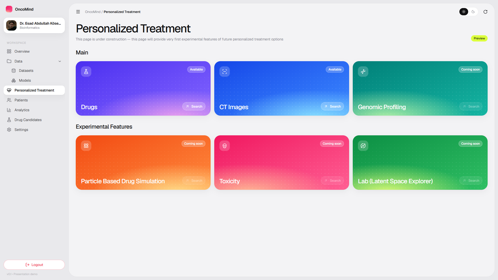

### Toxicity Analysis
ADMET prediction mapped onto the body: pick a drug candidate or paste a SMILES string, and every organ region lights up red when the drug is predicted to be toxic for it or green when it is clear.
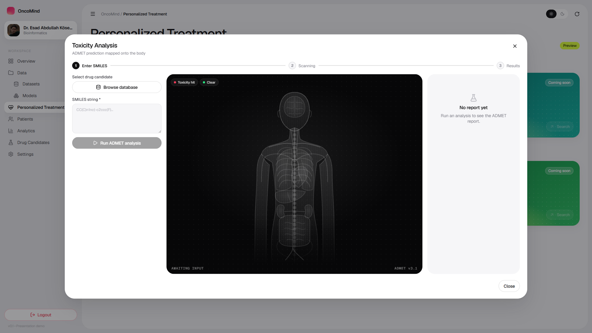

Test run with a generated drug candidate, the heart is flagged by the hERG (cardiac toxicity) prediction:
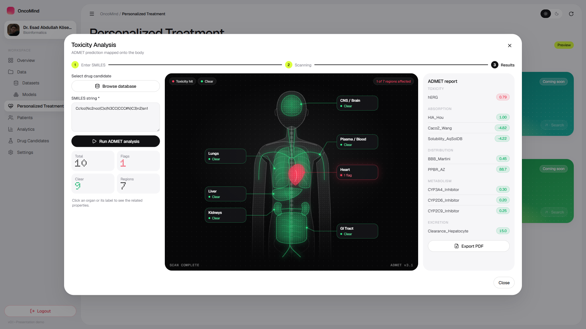

### Patients Page
Patients assigned to the signed-in doctor, with search, filters and patient registration.
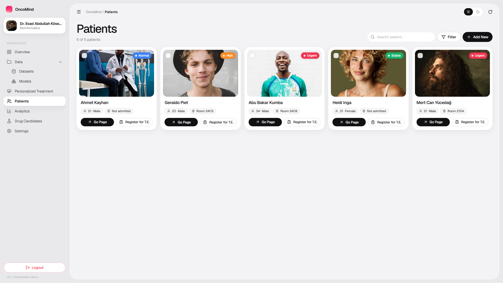

### Patient Info Page
Patient profile with status, room, examination count and examination history.
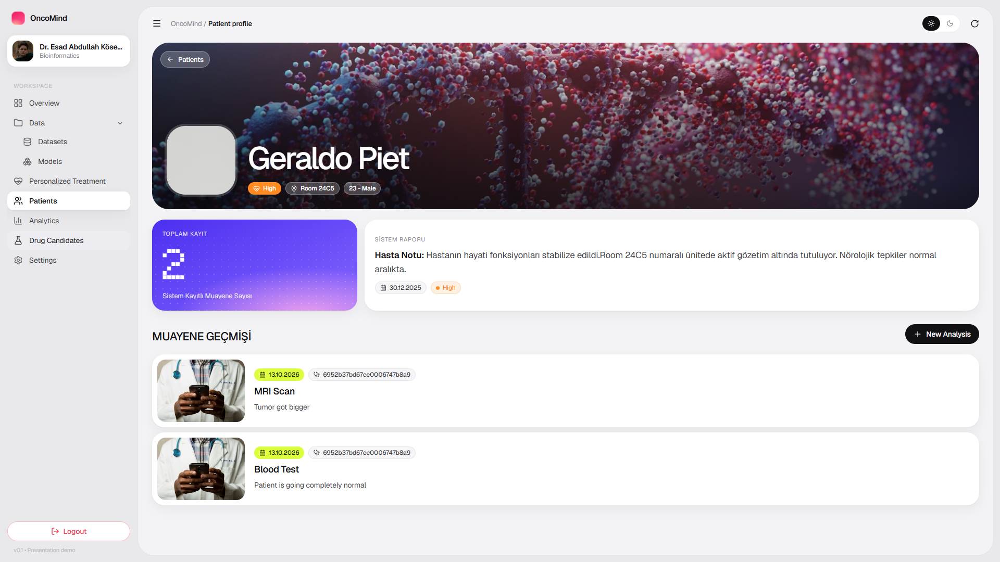

### Analytics Page
Patient status distribution, model training metrics, live model analysis from the ML service and recent admissions.
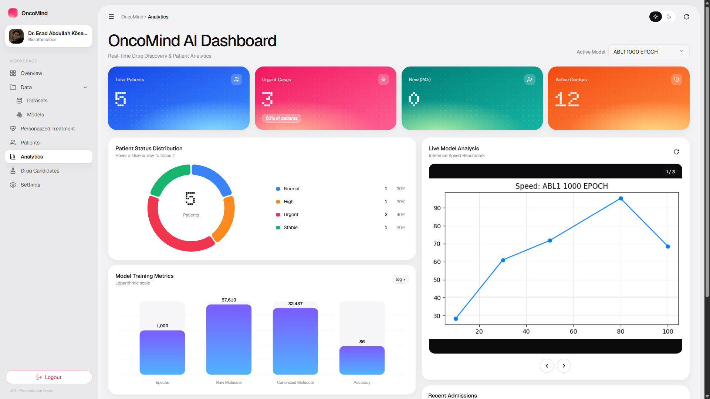

### Drug Candidates Page
AI generated drug candidate molecules with their QED and MW scores.
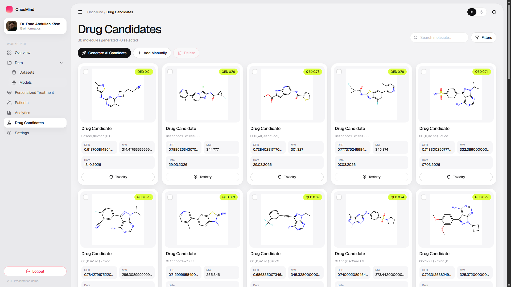

### Settings Page
System, user, emergency and API preferences.
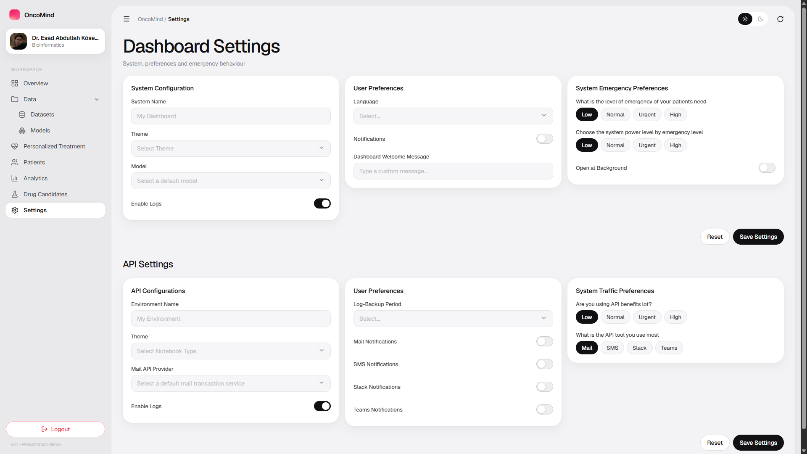


---

## 🔄 Converters

### Torch → ONNX

Run with:

```bash
python torch_to_onnx.py --model MODEL_PATH\<model_name>.pt --output OUTPUT_PATH\<model_name>.onnx
```
### cn3 to PDB format 

#### cn3_to_pdb.py

Run with:
```bash
python cn3_to_pdb.py --input example.cn3 --output example.pdb
```

